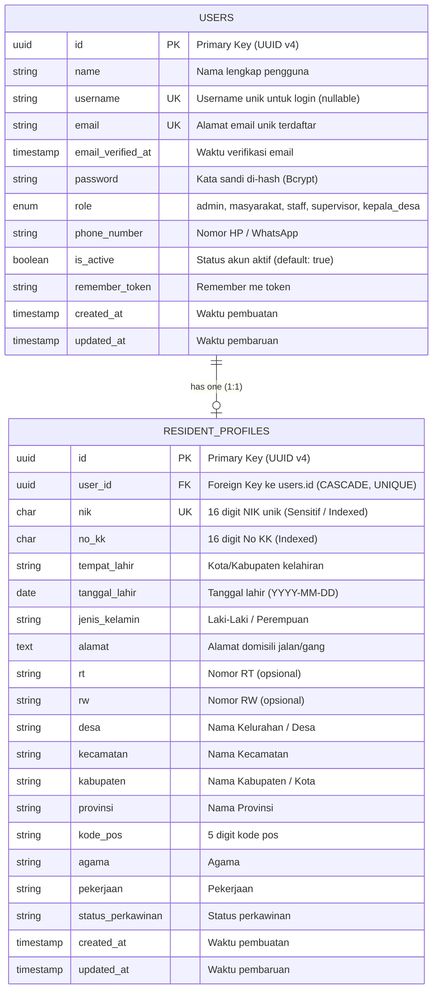

# Dokumentasi Struktur Database - Sistem Pelayanan Desa (SIPELDES)

Dokumen ini menjelaskan rancangan skema database, pemodelan data pengguna, prinsip keamanan data sensitif kependudukan, serta kesiapan integrasi untuk modul layanan desa di masa depan.

---

## 1. Diagram Relasi Entitas (ERD)

---

## 2. Rincian Kamus Data (Data Dictionary)

### A. Tabel: `users`
Tabel utama untuk kredensial autentikasi seluruh pengguna sistem (5 role).

| Kolom | Tipe Data | Nullable | Keterangan / Constraint |
|---|---|---|---|
| `id` | `UUID` (CHAR 36) | TIDAK | **PRIMARY KEY**. Menghindari enumerasi ID berurutan demi keamanan. |
| `name` | `VARCHAR(255)` | TIDAK | Nama lengkap pengguna. |
| `username` | `VARCHAR(50)` | YA | **UNIQUE**. Alternatif pengenal login untuk aparat/staff desa. |
| `email` | `VARCHAR(255)` | TIDAK | **UNIQUE**. Email utama untuk notifikasi dan login. |
| `email_verified_at` | `TIMESTAMP` | YA | Stempel waktu verifikasi email. |
| `password` | `VARCHAR(255)` | TIDAK | Kata sandi aman hasil hash **Bcrypt (12 rounds)**. |
| `role` | `VARCHAR(30)` | TIDAK | **INDEXED**. Enum: `admin`, `masyarakat`, `staff`, `supervisor`, `kepala_desa`. |
| `phone_number` | `VARCHAR(25)` | YA | Nomor kontak telepon/WhatsApp untuk pengiriman notifikasi status. |
| `is_active` | `BOOLEAN` | TIDAK | **INDEXED**. Default `true`. Kontrol penonaktifan akun oleh Admin. |
| `remember_token` | `VARCHAR(100)` | YA | Token otentikasi sesi persisten. |
| `created_at` | `TIMESTAMP` | YA | Audit pembuatan data. |
| `updated_at` | `TIMESTAMP` | YA | Audit perubahan data. |

---

### B. Tabel: `resident_profiles`
Menyimpan profil kependudukan (identitas sipil) khusus pemohon dengan peran `masyarakat`.

| Kolom | Tipe Data | Nullable | Keterangan / Constraint |
|---|---|---|---|
| `id` | `UUID` (CHAR 36) | TIDAK | **PRIMARY KEY**. |
| `user_id` | `UUID` (CHAR 36) | TIDAK | **FOREIGN KEY & UNIQUE**. Terhubung ke `users.id` dengan aturan `ON DELETE CASCADE`. |
| `nik` | `CHAR(16)` | TIDAK | **UNIQUE & INDEXED**. Nomor Induk Kependudukan (16 digit angka). |
| `no_kk` | `CHAR(16)` | TIDAK | **INDEXED**. Nomor Kartu Keluarga (16 digit angka). Dapat dimiliki lebih dari 1 warga sekeluarga. |
| `tempat_lahir` | `VARCHAR(100)` | TIDAK | Tempat lahir sesuai KTP. |
| `tanggal_lahir` | `DATE` | TIDAK | Format `YYYY-MM-DD`. |
| `jenis_kelamin` | `VARCHAR(20)` | TIDAK | Cast ke enum `Gender` (`Laki-Laki` / `Perempuan`). |
| `alamat` | `TEXT` | TIDAK | Nama jalan/gang, nomor rumah, dusun. |
| `rt` | `VARCHAR(5)` | YA | Nomor RT (contoh: '002'). |
| `rw` | `VARCHAR(5)` | YA | Nomor RW (contoh: '005'). |
| `desa` | `VARCHAR(100)` | TIDAK | Nama Desa/Kelurahan. |
| `kecamatan` | `VARCHAR(100)` | TIDAK | Nama Kecamatan. |
| `kabupaten` | `VARCHAR(100)` | TIDAK | Nama Kabupaten/Kota. |
| `provinsi` | `VARCHAR(100)` | TIDAK | Nama Provinsi. |
| `kode_pos` | `VARCHAR(10)` | YA | 5 digit kode pos. |
| `agama` | `VARCHAR(30)` | YA | Islam, Kristen, Katolik, Hindu, Buddha, Konghucu, dll. |
| `pekerjaan` | `VARCHAR(100)` | YA | Pekerjaan pemohon (misal: Buruh Harian, Pedagang, dll). |
| `status_perkawinan`| `VARCHAR(50)` | YA | Belum Kawin / Kawin / Cerai Hidup / Cerai Mati. |
| `created_at` | `TIMESTAMP` | YA | Audit pembuatan profil. |
| `updated_at` | `TIMESTAMP` | YA | Audit pembaruan profil. |

---

## 3. Prinsip Keamanan & Pelindungan Data Pribadi (UU PDP)

1. **Non-Plaintext Password**:
   - Disimpan menggunakan `Hash::make()` dengan algoritma Bcrypt 12 rounds.
   - Atribut password disembunyikan (`$hidden = ['password', 'remember_token']`) saat serialisasi JSON.

2. **Penggunaan UUID (Universally Unique Identifier)**:
   - Menggunakan UUID v4 pada seluruh tabel (`HasUuids` trait di Laravel).
   - Mencegah serangan *Insecure Direct Object Reference (IDOR)* dan tebakan ID berurutan (enumeration attack).

3. **Sensor Data Sensitif (Masking)**:
   - Model `ResidentProfile` dilengkapi aksesor `$profile->masked_nik` dan `$profile->masked_no_kk`.
   - Contoh: `3201011508900001` ditampilkan aman sebagai `320101******0001` (hanya 6 digit kode wilayah dan 4 digit urut yang tampak).

4. **Validasi Ketat**:
   - `ValidNik`: Memastikan 16 digit angka murni dan kode wilayah provinsi tidak kosong (`00`).
   - `ValidNoKk`: Memastikan 16 digit format kartu keluarga valid.

---

## 4. Kesiapan Skalabilitas Layanan Desa Masa Depan

Pemisahan antara tabel kredensial `users` dan data kependudukan `resident_profiles` memberikan keuntungan arsitektural:

1. **Layanan SKTM**:
   - Di tahap berikutnya, tabel `sktm_applications` cukup memiliki foreign key `user_id` atau `resident_profile_id`.
   - Data pemohon tidak perlu diduplikasi ulang setiap kali mengajukan permohonan baru.

2. **Layanan Desa Lainnya (SKU, SKD, Surat Pengantar Nikah, dll.)**:
   - Semua modul permohonan surat baru dapat menggunakan data kependudukan yang sudah terverifikasi dari `resident_profiles`.

3. **Alur Status / State Machine Workflow**:
   - Hubungan 5 peran:
     `Masyarakat (Draft/Submit)` $\rightarrow$ `Staff Desa (Check Admin)` $\rightarrow$ `Supervisor (Verifikasi)` $\rightarrow$ `Kepala Desa (Approval)` $\rightarrow$ `PDF Generator`.
