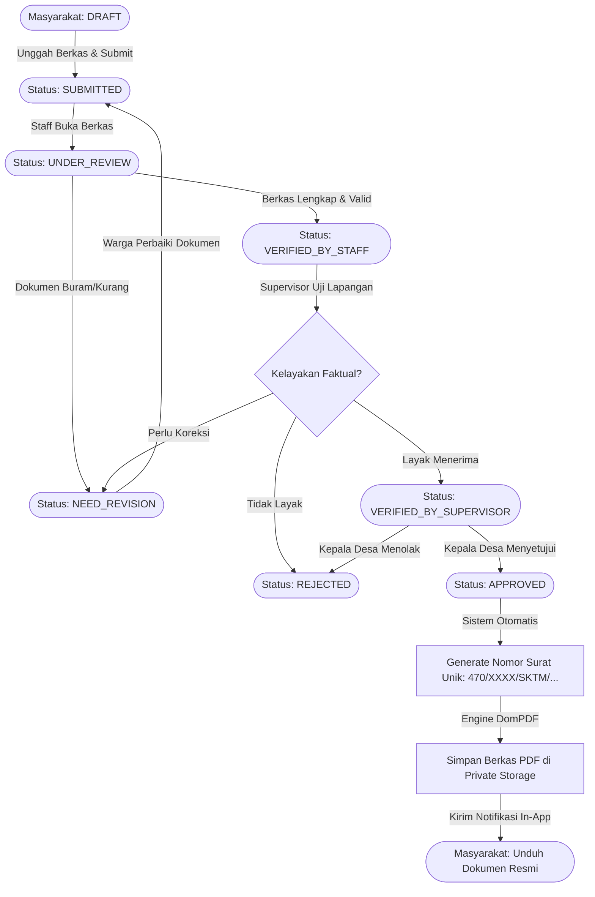

# Sistem Pelayanan Desa (SIPELDES) - MVP Surat Keterangan Tidak Mampu (SKTM)


-059669?style=flat-square&logo=checkmarx&logoColor=white)
-0284c7?style=flat-square&logo=shield&logoColor=white)


---

## 📖 1. Deskripsi Aplikasi

**SIPELDES (Sistem Informasi Pelayanan Desa Terpadu)** adalah aplikasi web pelayanan publik pemerintahan desa modern yang mendigitalisasi tata kelola permohonan surat administrasi kependudukan, dengan modul utama **Surat Keterangan Tidak Mampu (SKTM)**.

Aplikasi dirancang untuk menyelesaikan birokrasi manual yang rentan lambat, dokumen tercecer, atau penyalahgunaan wewenang melalui penerapan:
1. **Multi-Role Berjenjang (RBAC)**: Pemisahan wewenang yang tegas antara Masyarakat, Petugas Staff, Supervisor (Kasi Pelayanan), Kepala Desa, dan Administrator Sistem.
2. **Perlindungan Data Pribadi (UU PDP)**: Penyimpanan berkas kependudukan di private storage non-publik, pencegahan IDOR, dan sensor data sensitif (*Masking NIK & KK*).
3. **Penerbitan Surat Otomatis**: Generator PDF surat resmi berkop desa dengan format penomoran otomatis unik (`470/XXXX/SKTM/[Bulan Romawi]/[Tahun]`), ringkasan metadata, dan verifikasi integritas berkas (SHA-256).
4. **Pusat Notifikasi & Tracking Transparan**: Pelacakan riwayat 6 tahapan status dan notifikasi *in-app* untuk setiap aksi pemeriksaan.
5. **AI Assistant Terintegrasi**: 
   - **AI Document Check**: Pengecekan kesesuaian berkas KTP & KK terhadap data formulir menggunakan analisis multimodal vision/OCR (dengan disclaimer non-otomatisasi keputusan).
   - **AI Citizen Assistant**: Chatbot tanya-jawab interaktif berbasis *official village knowledge base* untuk membantu masyarakat memahami persyaratan dan alur layanan 24/7.

---

## 🛠️ 2. Tech Stack

| Komponen | Teknologi | Deskripsi & Peran |
|---|---|---|
| **Backend Framework** | **Laravel 12.x (PHP 8.3)** | MVC, Eloquent ORM, Form Requests, Custom Middleware, Services Layer, Form Request Throttling. |
| **Database** | **SQLite (Dev/Test) / MySQL (Production)** | Arsitektur UUID v4 (`HasUuids`), migrasi berstruktur, dan seeder relasional. |
| **PDF Generation** | **Barryvdh DomPDF** | Engine konversi template Blade HTML ke berkas fisik PDF resmi standar cetak A4. |
| **AI Multimodal & Chat** | **Google Gemini Vision & Knowledge Base** | Analisis dokumen OCR dan chatbot tanya-jawab warga dengan abstraction driver (*Gemini / Mock / Knowledge Base*). |
| **Frontend UI/UX** | **Blade Templating & CSS Vanilla Modern** | Antarmuka responsif mobile, Google Fonts (*Plus Jakarta Sans* & *Inter*), CSS variables, dialog konfirmasi, dan status badge. |
| **Testing Engine** | **PHPUnit / Pest** | 134 automated tests (719 assertions) mencakup Unit, Feature, Security, dan Full E2E Workflow. |
| **Code Style** | **Laravel Pint (PSR-12)** | Penyeragaman standarisasi gaya kode PHP otomatis. |

---

## ⚙️ 3. Installation (Panduan Instalasi)

### Prasyarat Sistem
- **PHP >= 8.3** (Ekstensi aktif: `pdo_sqlite`, `pdo_mysql`, `mbstring`, `fileinfo`, `gd`, `openssl`, `curl`)
- **Composer >= 2.x**
- Web Server (**Nginx** / **Apache** / **Laragon**)

### Langkah Instalasi
1. **Clone repositori dan masuk ke direktori proyek**:
   ```bash
   cd "c:\laragon\www\pelayanan desa"
   ```

2. **Install dependensi PHP via Composer**:
   ```bash
   composer install
   ```

3. **Salin file konfigurasi environment**:
   ```bash
   cp .env.example .env
   ```

4. **Generate kunci enkripsi aplikasi**:
   ```bash
   php artisan key:generate
   ```

5. **Inisialisasi database dan jalankan seeder**:
   ```bash
   php artisan migrate --seed
   ```

---

## 🔐 4. Environment Variables (`.env`)

Konfigurasikan variabel environment pada file `.env`:

```ini
APP_NAME=SIPELDES
APP_ENV=local
APP_KEY=base64:...
APP_DEBUG=true
APP_URL=http://localhost:8000

# Pengaturan Basis Data (Default Dev: SQLite)
DB_CONNECTION=sqlite
# Untuk MySQL:
# DB_CONNECTION=mysql
# DB_HOST=127.0.0.1
# DB_PORT=3306
# DB_DATABASE=pelayanan_desa
# DB_USERNAME=root
# DB_PASSWORD=

# Session & Cache
SESSION_DRIVER=database
SESSION_LIFETIME=120
CACHE_STORE=database
FILESYSTEM_DISK=local

# Konfigurasi AI Assistant & OCR
# Pilihan driver: 'mock' (pengujian tanpa internet) atau 'gemini' (API Google Gemini riil)
AI_DOCUMENT_CHECKER_DRIVER=mock
AI_CHAT_DRIVER=knowledge_base
AI_API_KEY=
AI_MODEL=gemini-1.5-flash

# Konfigurasi Identitas Pemerintahan Desa & Kop Surat
VILLAGE_NAME=Sukamaju
VILLAGE_KECAMATAN=Ciomas
VILLAGE_KABUPATEN="Kabupaten Bogor"
VILLAGE_PROVINSI="Jawa Barat"
VILLAGE_POSTAL_CODE=16610
VILLAGE_ADDRESS="Jl. Raya Sukamaju No. 123"
VILLAGE_PHONE="(0251) 863xxxx"
VILLAGE_EMAIL="desasukamaju@bogorkab.go.id"
VILLAGE_WEBSITE="sukamaju.desa.id"
VILLAGE_KADES_NAME="H. Suryono, S.Sos."
VILLAGE_KADES_TITLE="Kepala Desa Sukamaju"
VILLAGE_KADES_NIP="19750812 200212 1 003"
SKTM_KODE_SURAT=470
```

---

## 🗄️ 5. Database Setup & Seeder

### Struktur Entitas Utama
- `users`: Kredensial autentikasi multi-peran dengan Primary Key UUID v4.
- `resident_profiles`: Data kependudukan warga (NIK 16 digit, KK, tempat/tgl lahir, alamat domisili) terhubung `1-to-1` ke user.
- `sktm_applications`: Permohonan SKTM, data ekonomi, path berkas private KTP/KK, status tahapan, nomor surat, dan metadata PDF.
- `sktm_status_histories`: Riwayat audit *append-only* (pencatatan status awal, status baru, nama petugas, peran, catatan, timestamp).
- `app_notifications`: Pusat notifikasi in-app untuk warga.
- `ai_conversations` & `ai_messages`: Riwayat percakapan asisten virtual warga desa.

### Akun Demo Bawaan Seeder (`UserSeeder`)

| Peran (Role) | Email / Username | Password | Wewenang Utama |
|---|---|---|---|
| **Administrator** | `admin@desa.id` / `admin` | `Password123!` | Manajemen akun pengguna & sistem desa. |
| **Staff Desa** | `staff@desa.id` / `staff_budi` | `Password123!` | Pemeriksaan administrasi berkas & telaah AI. |
| **Supervisor** | `supervisor@desa.id` / `spv_siti` | `Password123!` | Uji kelayakan faktual & scoring rekomendasi. |
| **Kepala Desa** | `kades@desa.id` / `kades_ahmad` | `Password123!` | Persetujuan akhir (Approval) & pengesahan SKTM. |
| **Masyarakat** | `warga@desa.id` / `jokosusilo` | `Password123!` | Pemohon layanan, pelacakan, dan unduh surat. |

Untuk mereset basis data kapan saja:
```bash
php artisan migrate:fresh --seed
```

---

## 💻 6. Development

Jalankan web server lokal Laravel:
```bash
php artisan serve
```
Akses aplikasi melalui browser: [http://localhost:8000](http://localhost:8000).

- **Registrasi Warga**: Tersedia di `/register` untuk pendaftaran akun masyarakat baru mandiri.
- **Auto-Fill Akun Demo**: Pada mode `local`, landing page menyediakan kartu quick-login sekali klik untuk memudahkan pengujian semua role.
- **Formatting Kode**: Jalankan `vendor/bin/pint` sebelum commit kode baru.

---

## 🧪 7. Testing

Aplikasi dilengkapi cakupan pengujian komprehensif:

```bash
# Menjalankan seluruh test suite
php artisan test

# Menjalankan test workflow end-to-end lengkap
php artisan test tests/Feature/SktmCompleteWorkflowTest.php

# Menjalankan test audit keamanan (Security Hardening)
php artisan test tests/Feature/SecurityHardeningTest.php
```

### Ringkasan Cakupan Test Suite (134 Tests, 719 Assertions)
- `SktmCompleteWorkflowTest`: 13 skenario lengkap dari registrasi warga hingga download PDF, ditambah 8 skenario pengujian negatif.
- `SecurityHardeningTest`: Anti user-enumeration, IDOR, brute-force rate limiter, validasi upload file aman.
- `SktmAiDocumentCheckTest`: Pengujian rekomendasi AI Document Check, OCR matcher, dan disclaimer independensi keputusan.
- `AiAssistantCitizenTest`: Pengujian percakapan asisten virtual warga, session scoping, dan rate limiting.
- `SktmDocumentGenerationTest`: Pengujian validitas format nomor surat dan struktur PDF DomPDF.
- `RoleBasedAccessControlTest`: Pengujian batas wewenang ketat antar 5 role pengguna.

---

## 🚀 8. Production Deployment

Ikuti langkah-langkah berikut untuk deploy ke lingkungan server produksi (Ubuntu / AlmaLinux / Windows Server):

1. **Konfigurasi Lingkungan Produksi**:
   ```ini
   APP_ENV=production
   APP_DEBUG=false
   APP_URL=https://layanan.namadesa.go.id
   SESSION_SECURE_COOKIE=true
   ```

2. **Optimasi Cache Konfigurasi & Route**:
   ```bash
   php artisan config:cache
   php artisan route:cache
   php artisan view:cache
   ```

3. **Izin Hak Akses Direktori Storage**:
   Pastikan direktori `storage` dan `bootstrap/cache` memiliki izin tulis bagi user web server (misal: `www-data`):
   ```bash
   chmod -R 775 storage bootstrap/cache
   chown -R www-data:www-data storage bootstrap/cache
   ```

4. **Konfigurasi Web Server (Nginx)**:
   Arahkan root direktori Nginx ke folder `/public`:
   ```nginx
   server {
       listen 443 ssl http2;
       server_name layanan.namadesa.go.id;
       root /var/www/pelayanan-desa/public;

       index index.php;

       location / {
           try_files $uri $uri/ /index.php?$query_string;
       }

       location ~ \.php$ {
           include snippets/fastcgi-php.conf;
           fastcgi_pass unix:/var/run/php/php8.3-fpm.sock;
       }

       location ~ /\.(?!well-known).* {
           deny all;
       }
   }
   ```

---

## 👥 9. Struktur Role & Matriks Wewenang

```
[ADMIN] ──────> Mengelola Pengguna & Konfigurasi Sistem
[MASYARAKAT] ─> Registrasi -> Buat Draf -> Upload KTP/KK -> Submit -> Lacak -> Unduh PDF
[STAFF] ──────> Periksa Kelengkapan -> Telaah AI Check -> Minta Perbaikan / Verifikasi
[SUPERVISOR] ──> Verifikasi Faktual Kelayakan -> Kembalikan Perbaikan / Tolak / Setujui
[KEPALA DESA] ─> Otoritas Tunggal Approval Akhir -> Terbitkan Nomor Surat Resmi & PDF
```

| Fitur / Aksi | Masyarakat | Staff | Supervisor | Kepala Desa | Administrator |
|---|:---:|:---:|:---:|:---:|:---:|
| Registrasi & Buat Draf SKTM | ✅ | ❌ | ❌ | ❌ | ❌ |
| Akses Pengajuan Milik Sendiri | ✅ | ❌ | ❌ | ❌ | ❌ |
| Memeriksa Berkas Masuk (Review) | ❌ | ✅ | ❌ | ❌ | ❌ |
| Menjalankan AI Document Check | ❌ | ✅ | ❌ | ❌ | ❌ |
| Meneruskan ke Supervisor (`VERIFIED_BY_STAFF`) | ❌ | ✅ | ❌ | ❌ | ❌ |
| Verifikasi Kelayakan Faktual (`VERIFIED_BY_SUPERVISOR`) | ❌ | ❌ | ✅ | ❌ | ❌ |
| Persetujuan Akhir & Legalisasi (`APPROVED`) | ❌ | ❌ | ❌ | ✅ | ❌ |
| Unduh Dokumen PDF Resmi SKTM | ✅ (Milik Sendiri) | ✅ | ✅ | ✅ | ✅ |
| Nonaktifkan Akun Pengguna | ❌ | ❌ | ❌ | ❌ | ✅ |

---

## 🔄 10. Alur Kerja SKTM (Workflow 6 Tahapan)



### Rincian Tahapan:
1. **DRAFT**: Pemohon mengisi data identitas kependudukan dan keterangan ekonomi, serta dapat menyimpan permohonan terlebih dahulu sebelum melampirkan scan KTP/KK.
2. **SUBMITTED**: Pemohon melampirkan e-KTP dan KK (maks 3 MB, format PDF/JPG/PNG) dan mengirimkan permohonan secara resmi.
3. **UNDER_REVIEW**: Berkas otomatis berstatus *Sedang Diperiksa* saat pertama kali dibuka oleh Staff desa. Staff dibantu rekomendasi *AI Document Check*.
4. **NEED_REVISION**: Jika berkas buram atau data tidak cocok, Staff atau Supervisor mengembalikan berkas disertai catatan instruksi perbaikan yang jelas ke pemohon.
5. **VERIFIED_BY_STAFF & VERIFIED_BY_SUPERVISOR**: Penelaahan berjenjang yang menjamin integritas data administrasi sebelum sampai ke pimpinan desa.
6. **APPROVED & PDF ISSUANCE**: Kepala Desa memberikan legalisasi akhir. Sistem secara instan mencetak nomor surat unik berurutan, membuat PDF berkop resmi desa, mencatat riwayat audit permanen, dan mengaktifkan tautan unduhan bagi warga pemohon.
